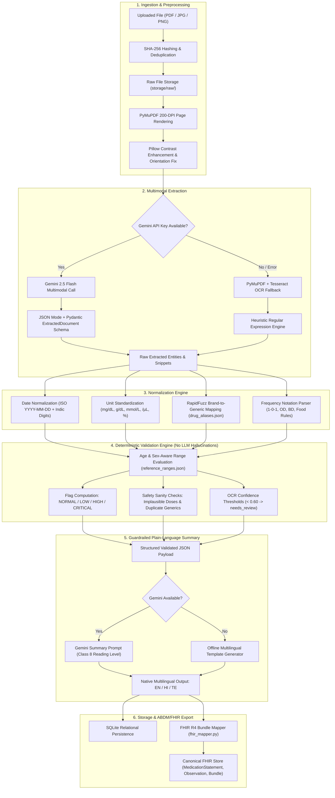
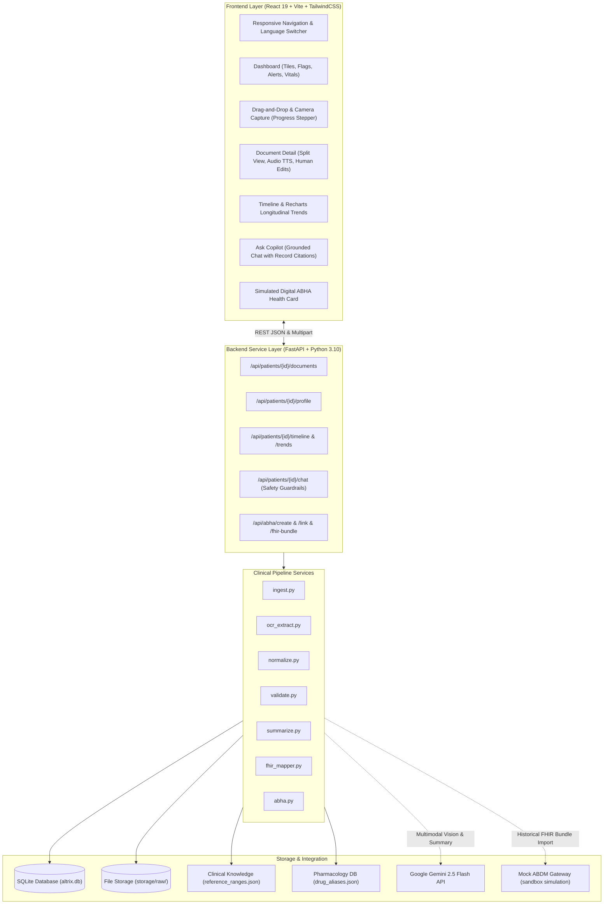
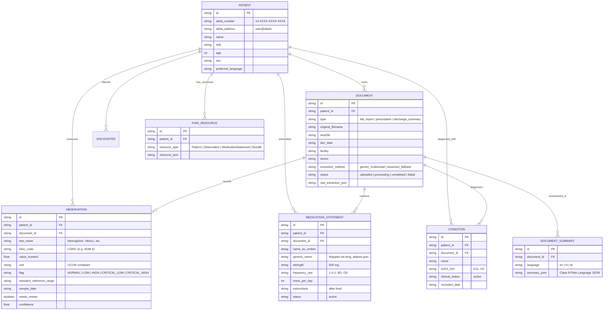

# Altrix Health Copilot Architecture Specification

## 1. System Overview
**Altrix Health Copilot** is a privacy-first, ABDM/FHIR R4-aligned personal health assistant designed for Indian clinical workflows. It processes heterogeneous, bilingual, and handwritten healthcare documents (PDF/JPG/PNG), extracts structured entities, deterministically flags abnormal clinical parameters without delegating clinical judgments to generative LLMs, provides empathetic Class 8 plain-language summaries in English, Hindi, and Telugu, and links everything to simulated ABHA credentials.

---

## 2. End-to-End Data Pipeline Architecture
The pipeline operates deterministically in six distinct phases per upload:

---

## 3. Component & Storage View

---

## 4. ABDM / FHIR R4 Data Model (Entity-Relationship Diagram)

---

## 5. Healthcare Safety & Guardrails
1. **Rule-Based Normal/Abnormal Categorization**: The LLM is never allowed to determine whether a lab value is normal, high, or critical. The validation engine performs deterministic boundary checks against validated reference ranges.
2. **Strict Refusal of Clinical Directives**: Red-team defenses intercept questions about altering, stopping, or increasing medication (e.g., "should I stop my metformin?") with firm directions to seek the prescribing physician's advice.
3. **Audio Accessibility**: Multilingual text-to-speech supports patient health literacy across diverse Indian language speakers via the Web Speech API (`en-IN`, `hi-IN`, `te-IN`).
4. **Auditability**: Original documents, 200-DPI high-fidelity rendered pages, raw extraction JSON, and confidence scores are preserved for every entity.
